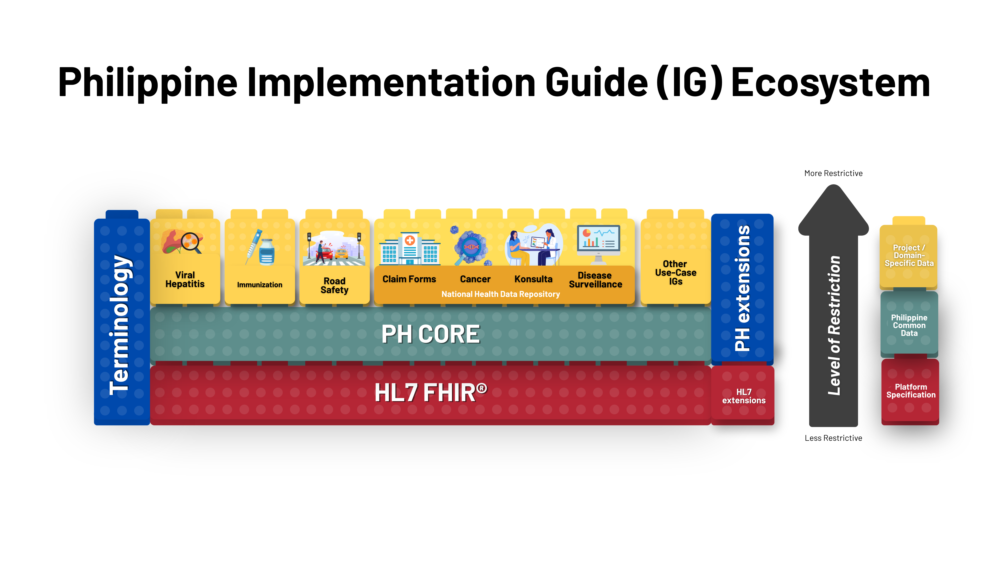

# Home - Draft PH Core Implementation Guide v0.2.1

## Home

### Draft Philippine Core FHIR Implementation Guide (PH Core IG)

> **Project Status: In Development**
 This Implementation Guide is under active development and is not yet available for public or production use. Content, data models, and implementation details are subject to change.

The Philippine Core FHIR Implementation Guide (PH Core IG) proposes a reusable baseline of clinical and administrative data representations for interoperable health information exchange in the Philippines. It provides a common, implementable foundation for health systems to consistently exchange data using the HL7® FHIR® standard.

PH Core IG standardizes commonly used FHIR profiles, extensions, terminology bindings, and conformance expectations that are applicable across health programs, facilities, and systems nationwide. Program- or use case–specific IGs can reuse these draft artifacts and define the additional requirements of their exchange contracts.

### Project Background

PH Core is actively being developed by UP Manila National TeleHealth Center, under the guidance of the Phillippines Department of Health, with technical assistance from CSIRO Australia.

The initial draft of IG will be tested in the Connectathon to validate proof of concept and direction settings for the Philippines Core IG development process.

### Purpose and Scope

The PH Core IG aims to:

1. Promote nationwide consistency and interoperability of health data
1. Support alignment with national policies such as JAO 2021-0002
1. Enable reuse of HL7 and international FHIR artifacts
1. Provide clear, testable specifications for system implementers

This guide focuses on core clinical and administrative resources (e.g., Patient, Practitioner, Organization, Encounter, Observation) that are widely applicable across multiple use cases. It does not define program-specific workflows or reporting payloads, which are addressed by downstream Implementation Guides.

### Usage of this Guide

* Health information systems implement PH Core profiles as a baseline for interoperability
* Program-specific IGs inherit from PH Core and apply additional constraints
* Developers and vendors use the guide to build and validate FHIR-conformant systems
* Policy and governance bodies use it as a reference for national standardization

### Development and Governance

The PH Core IG is developed through a collaborative, open, and standards-based process, involving the Department of Health (DOH), PhilHealth, UP Manila, and key technical partners. Development follows international best practices, uses open-source tooling (FHIR Shorthand, GitHub, IG Publisher), and is governed through structured review and change control mechanisms.

### Relationship with other IGs

**PH Core:**

* defines local representations, reference constraints, terminology bindings and explicitly selected actor obligations. The [Client and Server conformance requirements](client-server-conformance.md) define selectable REST capabilities without requiring every system to implement every profile or interaction.
* for use by the stakeholders in the Philippines when implementing FHIR to provide a common implementation and to be built upon when creating further profiles and implementation guides.
* conformance may become tied to regulatory and/or contractual agreements in order to necessitate adoption to this more prescriptive specification.

The context of PH Core within the set of FHIR Standards is shown in the diagram below.

### Usage

PH Core is particularly useful in defining:

* A testable level of system conformance
* Assumed support by client applications
* The basis of downstream implementation guides

Check each artifact for the constraints and obligations it actually declares. A reference-localization profile and a profile with selected support obligations have different contracts; base FHIR cardinalities continue to apply in both.

This working specification supports prototype implementation and review. The [example scenarios](examples.md) illustrate its current content; downstream IGs define their own workflows and server capabilities.

FHIR®© Connectathon events are key to the verification of the guide as being suitable for implementation. This implementation guide will be used as the basis for the Philippines Connectathon events.

### Dependencies

This publication includes IP covered under the following statements.

* This material contains content from [LOINC](http://loinc.org). LOINC is copyright © 1995-2020, Regenstrief Institute, Inc. and the Logical Observation Identifiers Names and Codes (LOINC) Committee and is available at no cost under the [license](http://loinc.org/license). LOINC® is a registered United States trademark of Regenstrief Institute, Inc.

* LOINC: [Bundle/bundle-acs-case-example](Bundle-bundle-acs-case-example.md), [Bundle/bundle-observation-provenance-example](Bundle-bundle-observation-provenance-example.md)... Show 17 more, [Bundle/transaction-example](Bundle-transaction-example.md), [Observation/observation-bp-example](Observation-observation-bp-example.md), [Observation/observation-component-unavailable](Observation-observation-component-unavailable.md), [Observation/observation-derived-bmi-example](Observation-observation-derived-bmi-example.md), [Observation/observation-environmental-temp-example](Observation-observation-environmental-temp-example.md), [Observation/observation-glucose-example](Observation-observation-glucose-example.md), [Observation/observation-height-example](Observation-observation-height-example.md), [Observation/observation-lab-panel-example](Observation-observation-lab-panel-example.md), [Observation/observation-part-of-procedure-example](Observation-observation-part-of-procedure-example.md), [Observation/observation-performer-role-example](Observation-observation-performer-role-example.md), [Observation/observation-potassium-example](Observation-observation-potassium-example.md), [Observation/observation-result-unavailable](Observation-observation-result-unavailable.md), [Observation/observation-sodium-example](Observation-observation-sodium-example.md), [Observation/observation-vitals-encounter-example](Observation-observation-vitals-encounter-example.md), [Observation/observation-weight-example](Observation-observation-weight-example.md), [Patient/patient-sex-and-gender-example](Patient-patient-sex-and-gender-example.md) and [Practitioner/practitioner-single-example](Practitioner-practitioner-single-example.md)

* This material contains content that is copyright of SNOMED International. Implementers of these specifications must have the appropriate SNOMED CT Affiliate license - for more information contact [https://www.snomed.org/get-snomed](https://www.snomed.org/get-snomed) or [info@snomed.org](mailto:info@snomed.org).

* [SNOMED Clinical Terms&reg; (SNOMED CT&reg;)](http://hl7.org/fhir/R4/codesystem-snomedct.html): [AllergyIntolerance/allergy-single-example](AllergyIntolerance-allergy-single-example.md), [Bundle/bundle-acs-case-example](Bundle-bundle-acs-case-example.md)... Show 23 more, [Bundle/bundle-allergy-provenance-example](Bundle-bundle-allergy-provenance-example.md), [Bundle/bundle-observation-provenance-example](Bundle-bundle-observation-provenance-example.md), [Bundle/transaction-example](Bundle-transaction-example.md), [Claim/claim-single-example](Claim-claim-single-example.md), [Condition/condition-appendicitis-example](Condition-condition-appendicitis-example.md), [Condition/condition-single-example](Condition-condition-single-example.md), [Immunization/immunization-single-example](Immunization-immunization-single-example.md), [Medication/medication-single-example](Medication-medication-single-example.md), [Observation/observation-bp-example](Observation-observation-bp-example.md), [Outpatient Department - General Medicine](HealthcareService-healthcareservice-single-example.md), [PHCoreMedication](StructureDefinition-ph-core-medication.md), [PHCoreMedicationAdministration](StructureDefinition-ph-core-medicationadministration.md), [PHCoreMedicationDispense](StructureDefinition-ph-core-medicationdispense.md), [PHCoreMedicationRequest](StructureDefinition-ph-core-medicationrequest.md), [PHCoreMedicationStatement](StructureDefinition-ph-core-medicationstatement.md), [PHCorePractitionerRole](StructureDefinition-ph-core-practitionerrole.md), [Patient/patient-sex-and-gender-example](Patient-patient-sex-and-gender-example.md), [Practitioner/practitioner-single-example](Practitioner-practitioner-single-example.md), [PractitionerRole/practitionerrole-single-example](PractitionerRole-practitionerrole-single-example.md), [Procedure/procedure-single-example](Procedure-procedure-single-example.md), [Procedure/procedure-unknown-date-example](Procedure-procedure-unknown-date-example.md), [ServiceRequest/servicerequest-appendectomy-example](ServiceRequest-servicerequest-appendectomy-example.md) and [ServiceRequest/servicerequest-single-example](ServiceRequest-servicerequest-single-example.md)

* This material derives from the HL7 Terminology (THO). THO is copyright ©1989+ Health Level Seven International and is made available under the CC0 designation. For more licensing information see: [https://terminology.hl7.org/license.html](https://terminology.hl7.org/license.html)

* [Admit source](http://terminology.hl7.org/7.4.0/CodeSystem-admit-source.html): [Bundle/bundle-acs-case-example](Bundle-bundle-acs-case-example.md)
* [AllergyIntolerance Clinical Status Codes](http://terminology.hl7.org/7.4.0/CodeSystem-allergyintolerance-clinical.html): [AllergyIntolerance/allergy-single-example](AllergyIntolerance-allergy-single-example.md) and [Bundle/bundle-allergy-provenance-example](Bundle-bundle-allergy-provenance-example.md)
* [AllergyIntolerance Verification Status](http://terminology.hl7.org/7.4.0/CodeSystem-allergyintolerance-verification.html): [AllergyIntolerance/allergy-single-example](AllergyIntolerance-allergy-single-example.md) and [Bundle/bundle-allergy-provenance-example](Bundle-bundle-allergy-provenance-example.md)
* [Claim Type Codes](http://terminology.hl7.org/7.4.0/CodeSystem-claim-type.html): [Claim/claim-single-example](Claim-claim-single-example.md)
* [Claim Care Team Role Codes](http://terminology.hl7.org/7.4.0/CodeSystem-claimcareteamrole.html): [Claim/claim-single-example](Claim-claim-single-example.md)
* [Condition Category Codes](http://terminology.hl7.org/7.4.0/CodeSystem-condition-category.html): [Bundle/bundle-acs-case-example](Bundle-bundle-acs-case-example.md), [Bundle/transaction-example](Bundle-transaction-example.md), [Condition/condition-appendicitis-example](Condition-condition-appendicitis-example.md) and [Condition/condition-single-example](Condition-condition-single-example.md)
* [Condition Clinical Status Codes](http://terminology.hl7.org/7.4.0/CodeSystem-condition-clinical.html): [Bundle/bundle-acs-case-example](Bundle-bundle-acs-case-example.md), [Bundle/transaction-example](Bundle-transaction-example.md), [Condition/condition-appendicitis-example](Condition-condition-appendicitis-example.md) and [Condition/condition-single-example](Condition-condition-single-example.md)
* [ConditionVerificationStatus](http://terminology.hl7.org/7.4.0/CodeSystem-condition-ver-status.html): [Bundle/bundle-acs-case-example](Bundle-bundle-acs-case-example.md), [Bundle/transaction-example](Bundle-transaction-example.md), [Condition/condition-appendicitis-example](Condition-condition-appendicitis-example.md) and [Condition/condition-single-example](Condition-condition-single-example.md)
* [DataAbsentReason](http://terminology.hl7.org/7.4.0/CodeSystem-data-absent-reason.html): [Observation/observation-component-unavailable](Observation-observation-component-unavailable.md) and [Observation/observation-result-unavailable](Observation-observation-result-unavailable.md)
* [Diagnosis Role](http://terminology.hl7.org/7.4.0/CodeSystem-diagnosis-role.html): [Bundle/bundle-acs-case-example](Bundle-bundle-acs-case-example.md)
* [Example Diagnosis Type Codes](http://terminology.hl7.org/7.4.0/CodeSystem-ex-diagnosistype.html): [Claim/claim-single-example](Claim-claim-single-example.md)
* [Immunization Funding Source](http://terminology.hl7.org/7.4.0/CodeSystem-immunization-funding-source.html): [Immunization/immunization-single-example](Immunization-immunization-single-example.md)
* [Location type](http://terminology.hl7.org/7.4.0/CodeSystem-location-physical-type.html): [Bundle/transaction-example](Bundle-transaction-example.md) and [Philippine General Hospital](Location-location-single-example.md)
* [MedicationDispense Performer Function Codes](http://terminology.hl7.org/7.4.0/CodeSystem-medicationdispense-performer-function.html): [Bundle/transaction-example](Bundle-transaction-example.md)
* [Observation Category Codes](http://terminology.hl7.org/7.4.0/CodeSystem-observation-category.html): [Bundle/bundle-acs-case-example](Bundle-bundle-acs-case-example.md), [Bundle/bundle-observation-provenance-example](Bundle-bundle-observation-provenance-example.md)... Show 15 more, [Bundle/transaction-example](Bundle-transaction-example.md), [Observation/observation-bp-example](Observation-observation-bp-example.md), [Observation/observation-component-unavailable](Observation-observation-component-unavailable.md), [Observation/observation-derived-bmi-example](Observation-observation-derived-bmi-example.md), [Observation/observation-environmental-temp-example](Observation-observation-environmental-temp-example.md), [Observation/observation-glucose-example](Observation-observation-glucose-example.md), [Observation/observation-height-example](Observation-observation-height-example.md), [Observation/observation-lab-panel-example](Observation-observation-lab-panel-example.md), [Observation/observation-part-of-procedure-example](Observation-observation-part-of-procedure-example.md), [Observation/observation-performer-role-example](Observation-observation-performer-role-example.md), [Observation/observation-potassium-example](Observation-observation-potassium-example.md), [Observation/observation-result-unavailable](Observation-observation-result-unavailable.md), [Observation/observation-sodium-example](Observation-observation-sodium-example.md), [Observation/observation-vitals-encounter-example](Observation-observation-vitals-encounter-example.md) and [Observation/observation-weight-example](Observation-observation-weight-example.md)
* [Organization type](http://terminology.hl7.org/7.4.0/CodeSystem-organization-type.html): [Bundle/bundle-acs-case-example](Bundle-bundle-acs-case-example.md), [Bundle/transaction-example](Bundle-transaction-example.md), [Philippine General Hospital](Organization-organization-pgh-example.md), [Philippine Health Insurance Corporation (illustrative)](Organization-organization-philhealth-example.md) and [Professional Regulation Commission (illustrative)](Organization-organization-prc-example.md)
* [Payee Type Codes](http://terminology.hl7.org/7.4.0/CodeSystem-payeetype.html): [Claim/claim-single-example](Claim-claim-single-example.md)
* [Practitioner role](http://terminology.hl7.org/7.4.0/CodeSystem-practitioner-role.html): [PHCorePractitionerRole](StructureDefinition-ph-core-practitionerrole.md)
* [Process Priority Codes](http://terminology.hl7.org/7.4.0/CodeSystem-processpriority.html): [Claim/claim-single-example](Claim-claim-single-example.md)
* [Provenance participant type](http://terminology.hl7.org/7.4.0/CodeSystem-provenance-participant-type.html): [Bundle/bundle-allergy-provenance-example](Bundle-bundle-allergy-provenance-example.md), [Bundle/bundle-observation-provenance-example](Bundle-bundle-observation-provenance-example.md) and [PHCoreProvenance](StructureDefinition-ph-core-provenance.md)
* [Service category](http://terminology.hl7.org/7.4.0/CodeSystem-service-category.html): [Outpatient Department - General Medicine](HealthcareService-healthcareservice-single-example.md)
* [Service type](http://terminology.hl7.org/7.4.0/CodeSystem-service-type.html): [Outpatient Department - General Medicine](HealthcareService-healthcareservice-single-example.md)
* [UsageContextType](http://terminology.hl7.org/7.4.0/CodeSystem-usage-context-type.html): [PHCoreClient](ActorDefinition-PHCoreClient.md) and [PHCoreServer](ActorDefinition-PHCoreServer.md)
* [identifierType](http://terminology.hl7.org/7.4.0/CodeSystem-v2-0203.html): [PHCoreOrganization](StructureDefinition-ph-core-organization.md), [PHCorePatient](StructureDefinition-ph-core-patient.md), [PHCoreRelatedPerson](StructureDefinition-ph-core-relatedperson.md) and [RelatedPerson/relatedperson-single-example](RelatedPerson-relatedperson-single-example.md)
* [providerRole](http://terminology.hl7.org/7.4.0/CodeSystem-v2-0443.html): [Immunization/immunization-single-example](Immunization-immunization-single-example.md)
* [ActCode](http://terminology.hl7.org/7.4.0/CodeSystem-v3-ActCode.html): [Bundle/bundle-acs-case-example](Bundle-bundle-acs-case-example.md), [Bundle/transaction-example](Bundle-transaction-example.md), [Encounter/encounter-immunization-example](Encounter-encounter-immunization-example.md), [Encounter/encounter-single-example](Encounter-encounter-single-example.md) and [Encounter/encounter-surgery-example](Encounter-encounter-surgery-example.md)
* [ActPriority](http://terminology.hl7.org/7.4.0/CodeSystem-v3-ActPriority.html): [Bundle/bundle-acs-case-example](Bundle-bundle-acs-case-example.md)
* [ActSite](http://terminology.hl7.org/7.4.0/CodeSystem-v3-ActSite.html): [Immunization/immunization-single-example](Immunization-immunization-single-example.md)
* [DataOperation](http://terminology.hl7.org/7.4.0/CodeSystem-v3-DataOperation.html): [Bundle/bundle-allergy-provenance-example](Bundle-bundle-allergy-provenance-example.md) and [Bundle/bundle-observation-provenance-example](Bundle-bundle-observation-provenance-example.md)
* [ObservationInterpretation](http://terminology.hl7.org/7.4.0/CodeSystem-v3-ObservationInterpretation.html): [Bundle/bundle-acs-case-example](Bundle-bundle-acs-case-example.md), [Bundle/bundle-observation-provenance-example](Bundle-bundle-observation-provenance-example.md)... Show 7 more, [Bundle/transaction-example](Bundle-transaction-example.md), [Observation/observation-bp-example](Observation-observation-bp-example.md), [Observation/observation-derived-bmi-example](Observation-observation-derived-bmi-example.md), [Observation/observation-glucose-example](Observation-observation-glucose-example.md), [Observation/observation-performer-role-example](Observation-observation-performer-role-example.md), [Observation/observation-potassium-example](Observation-observation-potassium-example.md) and [Observation/observation-sodium-example](Observation-observation-sodium-example.md)
* [ParticipationType](http://terminology.hl7.org/7.4.0/CodeSystem-v3-ParticipationType.html): [Bundle/bundle-acs-case-example](Bundle-bundle-acs-case-example.md), [Bundle/transaction-example](Bundle-transaction-example.md) and [Encounter/encounter-single-example](Encounter-encounter-single-example.md)
* [Race](http://terminology.hl7.org/7.4.0/CodeSystem-v3-Race.html): [Bundle/bundle-acs-case-example](Bundle-bundle-acs-case-example.md), [Bundle/transaction-example](Bundle-transaction-example.md), [Patient/patient-single-example](Patient-patient-single-example.md) and [Race](StructureDefinition-race.md)
* [Religious Affiliation](http://terminology.hl7.org/7.4.0/CodeSystem-v3-ReligiousAffiliation.html): [Bundle/bundle-acs-case-example](Bundle-bundle-acs-case-example.md), [Bundle/transaction-example](Bundle-transaction-example.md) and [Patient/patient-single-example](Patient-patient-single-example.md)
* [RoleCode](http://terminology.hl7.org/7.4.0/CodeSystem-v3-RoleCode.html): [Bundle/transaction-example](Bundle-transaction-example.md), [Philippine General Hospital](Location-location-single-example.md) and [RelatedPerson/relatedperson-single-example](RelatedPerson-relatedperson-single-example.md)
* [RouteOfAdministration](http://terminology.hl7.org/7.4.0/CodeSystem-v3-RouteOfAdministration.html): [Bundle/transaction-example](Bundle-transaction-example.md) and [Immunization/immunization-single-example](Immunization-immunization-single-example.md)

This is an R4 IG. None of the features it uses are changed in R4B, so it can be used as is with R4B systems. Packages for both [R4 (fhir.ph.core.r4)](../package.r4.tgz) and [R4B (fhir.ph.core.r4b)](../package.r4b.tgz) are available.

| | | |
| :--- | :--- | :--- |
| [FHIR Extensions Pack](http://hl7.org/fhir/extensions/5.3.0) | [5.3.0](https://simplifier.net/packages/hl7.fhir.uv.extensions.r4/5.3.0) |  |
| [5.2.0](https://simplifier.net/packages/hl7.fhir.uv.extensions.r4/5.2.0) | Imported by HL7 Terminology (THO) (and potentially others) | |
| [FHIR R4 package : Core](http://hl7.org/fhir/R4) | [4.0.1](https://simplifier.net/packages/hl7.fhir.r4.core/4.0.1) | Imported by HL7 Terminology (THO) (and potentially others) |
| [HL7 Terminology (THO)](http://terminology.hl7.org/7.4.0) | [7.4.0](https://simplifier.net/packages/hl7.terminology.r4/7.4.0) | Automatically added as a dependency - all IGs depend on HL7 Terminology |
| [7.1.0](https://simplifier.net/packages/hl7.terminology.r4/7.1.0) | Imported by FHIR Extensions Pack (and potentially others) | |

*There are no Global profiles defined*

